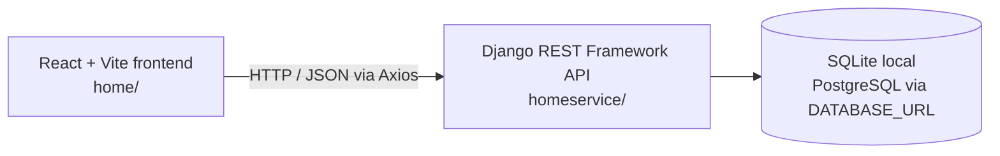

# Smart Home Service Platform

A full-stack home-services booking platform built with React and Django REST Framework. Customers can find service categories, choose a worker, and submit a booking request. Workers can manage their assigned requests, while administrators manage the service catalog, cities, workers, and user accounts.

**Live demo:** [homeservice-ecru.vercel.app](https://homeservice-ecru.vercel.app/) · The link is provided for reference; it was not reachable through the available check during this README update.

## Overview

Finding and coordinating help for routine home maintenance can involve contacting service providers one at a time. This project brings service discovery, booking requests, worker coordination, and basic administration into a single web application.

The repository contains two applications:

- `home/` — React single-page frontend, built with Vite.
- `homeservice/` — Django REST Framework API and SQLite/PostgreSQL database configuration.

## Features

### Customers

- Create an account and sign in with email and password.
- Browse the service catalog and view available workers.
- Request a service by selecting a service, worker, date, and address.
- View bookings, update profile details, and cancel a booking.

### Workers

- Register for a service category.
- View bookings assigned to the worker account.
- Accept, reject, or mark assigned bookings complete.
- Update profile details.

### Administrators

- View and manage service categories and supported cities.
- Review workers, approve them, and change their availability.
- Add, edit, search, filter, and delete user accounts, including worker accounts.
- View dashboard summaries and edit the admin profile.

### Service catalog

Service categories are stored in the backend database and managed through the admin dashboard; the repository does not define a fixed catalog or seed list. The frontend includes display handling for names containing Electrician, Painter, Cleaning, Carpentry, Plumbing/Repair, AC/Air Conditioning, and Pest. The actual available categories depend on the `Service` records in the running database. Sweeper, Welder, and Labour were not confirmed as configured services in the repository.

## Technology stack

| Area | Technologies |
| --- | --- |
| Frontend | React 19, React Router, Vite, Axios, Framer Motion, React Icons, Recharts, React Toastify |
| Backend | Python, Django 6, Django REST Framework, Simple JWT package, django-cors-headers |
| Database | SQLite by default for local development; PostgreSQL when `DATABASE_URL` is set |
| Development and deployment | Node.js/npm, Python/pip, Django migrations, Vercel frontend configuration, Gunicorn and WhiteNoise dependencies |

> The current login view checks email and password and returns the user's role and ID. Although Simple JWT is installed and configured in Django settings, the login route does not issue a JWT. The API views also do not currently enforce role-based permissions; treat the role-specific screens as application UI, not as a security boundary.

## Architecture



The frontend reads `VITE_API_BASE_URL` when provided. Otherwise it uses `http://127.0.0.1:8000/` during Vite development and the configured Render API URL in production builds.

## Screenshots

No project screenshots were present in the repository, and the live application could not be accessed with the available web check. No screenshots are included or represented as captures. To complete this section, provide genuine captures of:

- Homepage / service catalog
- Login or sign-up page
- Customer dashboard and bookings
- Worker dashboard
- Admin dashboard (with sensitive personal information hidden)

Once supplied, place the images in `screenshots/` and add relative Markdown image links here.

## Local setup

### Prerequisites

- Node.js and npm
- Python and pip, using a Python version supported by Django 6
- Git

### 1. Clone the repository

```bash
git clone https://github.com/ashishparihar679/smarthome.git
cd smarthome
```

### 2. Configure the backend

Create and activate a virtual environment, then install the backend requirements:

```bash
python -m venv venv
# macOS/Linux:
source venv/bin/activate
# Windows PowerShell:
# .\venv\Scripts\Activate.ps1
python -m pip install -r homeservice/requirements.txt
```

The Django settings read environment variables from the process; this repository does not load `.env` files. In PowerShell, set them in the same terminal that will run Django:

```powershell
$env:SECRET_KEY = "<development-secret>"
$env:DEBUG = "True"
# Optional; omit for the default local SQLite database.
$env:DATABASE_URL = "<postgresql-connection-url>"
```

For macOS/Linux shells, use `export SECRET_KEY="<development-secret>"` and `export DEBUG=True`; set `DATABASE_URL` only when using PostgreSQL. Locally, SQLite is selected when `DATABASE_URL` is unset. `SECRET_KEY` has a development fallback in settings, but use a private value locally and a secure value in deployment. Do not commit secrets. `DEBUG` defaults to `False`.

Run the migrations and start the API:

```bash
cd homeservice
python manage.py migrate
python manage.py runserver
```

The API will be available at `http://127.0.0.1:8000/`. Django's admin site is mounted at `/admin/`; create a staff account with `python manage.py createsuperuser` if needed.

### 3. Configure and start the frontend

In a second terminal, from the repository root:

```bash
cd home
npm install
```

Optionally set the API base URL before starting Vite. The value should include the trailing slash, for example `http://127.0.0.1:8000/`. In PowerShell:

```powershell
$env:VITE_API_BASE_URL = "<backend-base-url-ending-in-slash>"
```

In macOS/Linux shells, use `export VITE_API_BASE_URL="<backend-base-url-ending-in-slash>"`.

Then run the frontend:

```bash
npm run dev
```

Vite prints the local frontend URL, normally `http://localhost:5173/`. To create a production build, run `npm run build` from `home/`.

## Routes

### Frontend routes

| Path | Page |
| --- | --- |
| `/` | Service catalog / homepage |
| `/workers` | Worker listing |
| `/booking` | Booking form |
| `/my-bookings` | Booking list |
| `/UserDashboard` | Customer dashboard |
| `/worker-dashboard` | Worker dashboard |
| `/admin` | Admin dashboard |
| `/AdminUsers` | Admin user management |
| `/Login` | Sign-in |
| `/Signup` | Account creation |
| `/WorkerRegister` | Worker registration form |

The API endpoints below are registered in `homeservice/subapp/urls.py`; the API is mounted at the backend root.

| Method | Endpoint | Purpose |
| --- | --- | --- |
| `GET`, `POST` | `/services/` | List or create services |
| `DELETE` | `/services/delete/{id}/` | Delete a service |
| `GET`, `POST` | `/cities/` | List or create cities |
| `DELETE` | `/cities/delete/{id}/` | Delete a city |
| `GET`, `POST` | `/workers/` | List or create workers |
| `GET`, `POST` | `/bookings/` | List bookings or create a booking |
| `GET` | `/worker/bookings/?worker={id}` | List bookings for a worker ID |
| `PUT` | `/booking/accept/{id}/`, `/booking/reject/{id}/`, `/booking/complete/{id}/`, `/booking/cancel/{id}/` | Change booking status |
| `POST` | `/register/`, `/login/` | Register an account or sign in |
| `GET`, `PUT` | `/user/profile/{id}/` | Read or update a profile |
| `PUT` | `/worker/approve/{id}/`, `/worker/availability/{id}/` | Approve a worker or toggle availability |
| `GET` | `/users/` | List users |
| `POST`, `PUT`, `DELETE` | `/user/add/`, `/user/update/{id}/`, `/user/delete/{id}/` | Manage user accounts |

## Future improvements

These are potential next steps, not claims about current functionality:

- Enforce authentication and role-based authorization on protected API operations.
- Issue and validate access/refresh tokens in the sign-in flow.
- Add automated tests for booking lifecycle, permissions, and account management.
- Add service seed data and documented deployment environment configuration.
- Add real screenshots and a verified API schema or interactive API documentation.

## Author

**Ashish Ahirwar**

GitHub: [@ashishparihar679](https://github.com/ashishparihar679)
